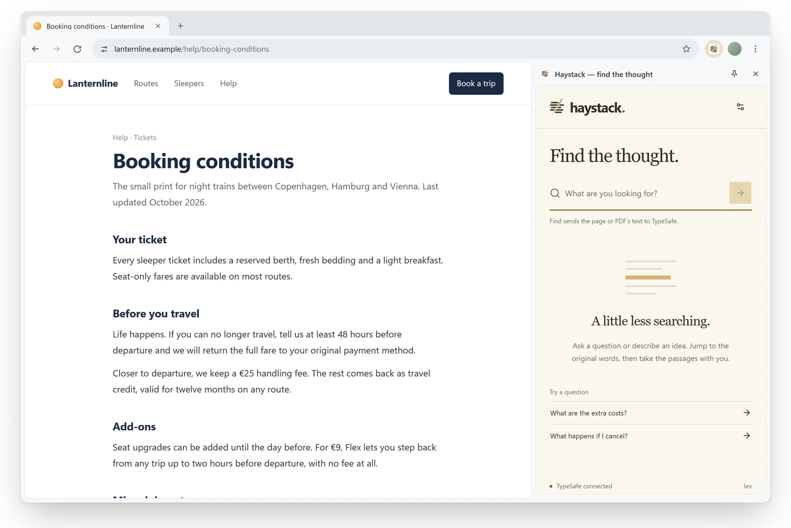
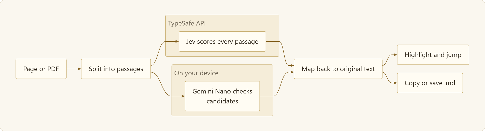

<p align="center"></p>

Haystack is a Chrome and Firefox extension that searches the page you're reading by meaning, not keywords. Ask a question, jump to the original passages, and take every match with you as Markdown. It finds source text. It never writes an answer.

<p align="center"></p>

<p align="center"><sub>Real Jev results on a sample page. Ctrl+F finds no “cancel” here. Haystack finds the passages that answer the question.</sub></p>

## Two engines

| | TypeSafe Jev | Chrome local (Gemini Nano) |
| --- | --- | --- |
| Browsers | Chrome and Firefox | Eligible desktop Chrome 138+ |
| Your text goes to | TypeSafe, with your own key | Nowhere; it stays on your device |
| Results | Ranked by relevance, adjustable threshold | Page order, quote-checked against the source |
| Status | Default | Experimental |

**Need a key?** [typesafe.ai](https://typesafe.ai/) gives you $5 of free credit, no credit card required.

## Install

You need Git, Node.js 24 LTS and npm.

```sh
git clone https://github.com/ossianravn/haystack.git
cd haystack
npm ci
npm run build
```

- **Chrome 125+:** open `chrome://extensions`, turn on **Developer mode**, click **Load unpacked** and choose `dist/chrome`.
- **Firefox 149+:** open `about:debugging#/runtime/this-firefox`, click **Load Temporary Add-on** and choose `dist/firefox/manifest.json`. It stays until Firefox restarts; a permanent install needs [Mozilla signing](https://extensionworkshop.com/documentation/publish/signing-and-distribution-overview/).

Click the toolbar icon or press **Ctrl+Shift+Y** (**⌘⇧Y** on macOS), then connect your TypeSafe key or set up Chrome local.

To update, run `git pull`, `npm ci` and `npm run build`, then reload the extension and the page.

## Use it

- Type a question and press **Enter**. Click a result, or use ↑ and ↓, to jump to it on the page.
- **Copy all** or **Save .md** exports every match in page order, with the page title, URL and your query.
- PDFs work too: open the PDF in its own tab and search. Results link to their PDF page. Scanned PDFs without a text layer can't be searched.
- Jev keeps matches scoring 58% or more. Change the threshold in Settings.

## How it works

<picture>
  <source media="(prefers-color-scheme: dark)" srcset="docs/images/how-it-works-dark.png">
  
</picture>

Every result is mapped back to words that are already on the page, and anything that can't be found there is dropped. Highlights use the CSS Custom Highlight API, so the page's markup is never touched.

## Privacy

- No Haystack server, no analytics, no search history.
- With Jev, the page text and your query go straight to TypeSafe. Your key stays in extension-local storage and is never synced.
- With Chrome local, nothing leaves your device, and Haystack never falls back to TypeSafe on its own.
- Access is per page through `activeTab`, not a standing permission for every site.

## More

- [Guide](docs/guide.md): exports, Chrome local, PDFs, data handling, page coverage, troubleshooting.
- [Development](docs/development.md): build output, tests, live and browser checks, architecture.

## License

No license has been chosen for Haystack's own code yet, so this repository doesn't grant an open-source license to it. Third-party code keeps its own licenses; see [THIRD_PARTY_NOTICES.md](THIRD_PARTY_NOTICES.md). Each build includes dependency license texts in `LICENSES.txt`.
